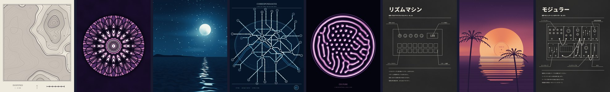
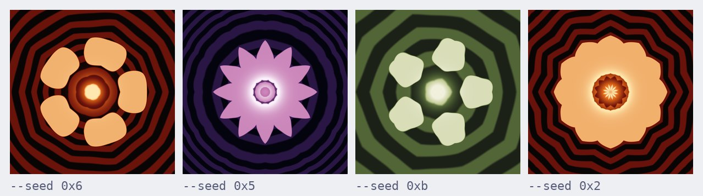
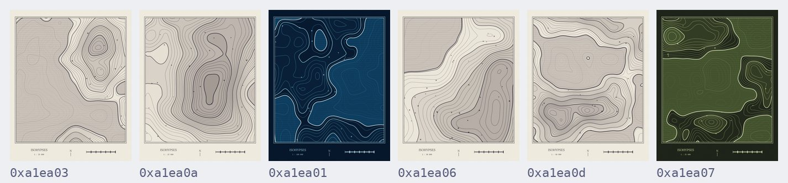
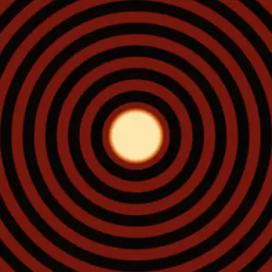
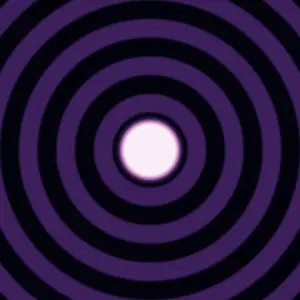
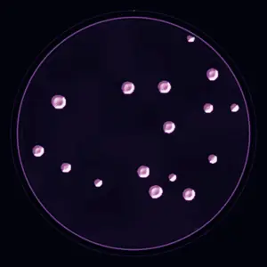
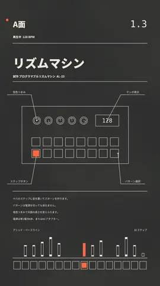
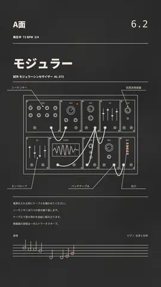
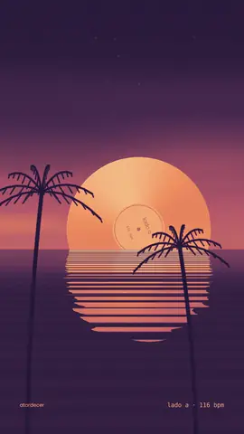
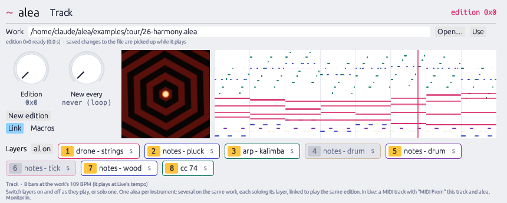

<p align="center">
  <a href="https://alea.bngz.io"></a>
</p>

<h1 align="center">alea</h1>

<p align="center">
  <strong>Code that paints. Every run, a new edition.</strong><br>
  A programming language for generative art: write a work once, and alea draws<br>
  endless editions of it, as images, videos, sounds, 3D sculptures or MIDI.
</p>

<p align="center">
  <a href="https://alea.bngz.io/playground.html"><strong>Try it in your browser</strong></a> ·
  <a href="https://alea.bngz.io">Website</a> ·
  <a href="https://alea.bngz.io/handbook.html">Handbook</a> ·
  <a href="#install">Install</a> ·
  <a href="https://www.instagram.com/sudo.mp3/">Instagram</a>
</p>

<p align="center">
  <a href="https://github.com/sudo-bngz/alea/actions/workflows/ci.yml"></a>
  <a href="https://github.com/sudo-bngz/alea/releases/latest"></a>
  <a href="LICENSE"></a>
</p>

---

## Thirteen lines, endless rose windows

```alea
// Rosace — one wobbly petal, folded into a rose window.

work Rosace {
  let petal  = blob(x: 0.72, y: 0.5, size: 0.22)
  let lace   = ripples(x: 0.5, y: 0.5) * 0.35
  let window = kaleidoscope(warp(merge(petal, lace)),
                            sides: choose { 5 | 6 | 8 | 12 })

  output window + glow(x: 0.5, y: 0.5, size: 0.25)

  render image(output,
               palette: choose { "ember" | "lichen" | "night" })
}
```

<p align="center"></p>

`blob()` doesn't say where or how big: alea decides. `choose` picks the
symmetry and the palette. Run it and you get a rose window no one has seen;
each one is named by its **seed**, and the same seed gives back the same
picture, byte for byte, on any machine and in the browser.

```sh
alea rosace.alea                # a new edition: rosace-<seed>.png
alea rosace.alea -n 20          # twenty of them
alea rosace.alea --seed 0x5     # the purple star above, again
```

## One program, a whole series

<p align="center"></p>

[Isohypses](exhibition/isohypses.alea) draws maps of places that don't
exist: contour lines over an imaginary relief, a hatched sea, towns, and
the cartouche of a survey sheet. Six seeds, six countries. It is part of
the [exhibition](exhibition/), posted on
[Instagram @sudo.mp3](https://www.instagram.com/sudo.mp3/).

## It moves, and it sounds

<table>
<tr>
<td width="50%">

```alea
work Breathing {
  let pulse = lfo()        // 0 → 1 → 0, once per video
  let heart = circle(x: 0.5, y: 0.5,
                     size: 0.2 + 0.15 * pulse)
  let rings = ripples(x: 0.5, y: 0.5,
                      count: choose { 8 | 12 | 16 }) * 0.35
  let petals = kaleidoscope(stripes(count: 6, angle: t * 360),
                            sides: choose { 5 | 6 | 8 })

  output merge(heart, mix(rings, petals * 0.5, pulse))

  render video(output, duration: 8,
               palette: choose { "ember" | "sea" | "night" })
}
```

</td>
<td width="25%"></td>
<td width="25%"></td>
</tr>
</table>

`t` is time. Built on `lfo()`, the motion comes back to where it started, so
the video loops seamlessly. Add `render sound(…)` and the same edition has
its own soundtrack; `render sculpture(…)` gives an STL to print in 3D;
`render midi(…)` writes a score, with chords, arpeggios and rhythms, that
plays in your DAW.

**Instruments of your own.** `synth { … }` builds one from oscillators,
envelopes and filters: `lowpass(saw(), cutoff: 300 + 3000 * perc(release: 0.2))`
is a bass that snaps shut, and a `~` inside gives each edition its own
timbre. See [examples/synths.alea](examples/synths.alea) and
[the built-in instruments, written as synths](examples/instruments/).

<table>
<tr>
<td width="30%"></td>
<td>
<strong>Fields with a memory.</strong> <a href="exhibition/culture.alea">Culture</a> seeds colonies
at random in a petri dish and lets them grow by reaction–diffusion: each
generation computed from the last, in a <code>grow</code> block. Seventy-two hours of
incubation in twenty seconds.
</td>
</tr>
</table>

<table>
<tr>
<td width="25%"></td>
<td width="25%"></td>
<td width="25%"></td>
<td>
<strong>The picture and the music, one program.</strong>
<a href="exhibition/kikai.alea">Kikai</a> draws a machine that never existed and
plays Detroit techno on it; <a href="exhibition/kairo.alea">Kairo</a> racks a
modular synthesizer that plays a slow piano waltz;
<a href="exhibition/atardecer.alea">Atardecer</a> sets a record into the sea over
lofi house. Every instrument is a <code>synth</code>, and the notes you hear are
the ones drawn.
</td>
</tr>
</table>

## What you can make

| `render …` | You get |
|---|---|
| `image` | a PNG, any size, painted with a named palette or your own colours |
| `video` | an MP4 that loops, with its sound (needs [ffmpeg](https://ffmpeg.org)) |
| `sound` | a WAV: drones, notes, textures, rhythms, drawn from the same edition |
| `sculpture` | an STL relief, ready for a 3D printer |
| `midi` | a MIDI file, or MIDI played live into your DAW, in time with its clock |
| `--web page.html` | one self-contained web page that draws a new edition at every visit |

Works can use other works as parts, take a photo or a sound as input, and
read and write pipes: `cat photo.png | alea riso.alea > print.png` prints a
photo in three inks, with a new registration every edition.

**In your DAW.** The [plugin](plugin/) (VST3 and CLAP) plays a work's music
in time with Ableton Live, Bitwig or Reaper, a new edition every few bars,
each layer to its own instrument.

<p align="center"></p>

## Install

**Nothing to install:** the [playground](https://alea.bngz.io/playground.html) runs alea in the browser, with examples and the tour.

**macOS and Linux:**

```sh
brew install sudo-bngz/tap/alea
```

**Any system:** download alea for macOS, Linux (x86_64, arm64) or Windows,
and the plugin, from the [latest release](https://github.com/sudo-bngz/alea/releases/latest).
On macOS, the first time: `xattr -d com.apple.quarantine alea`.

**With Rust:** `cargo install alea-lang` (the command is `alea`; add
`--features midi` for live MIDI, after `libasound2-dev` on Linux).

**Editor:** syntax highlighting for VS Code and compatible editors in
[editors/vscode](editors/vscode/).

## Learn

| | |
|---|---|
| **[The guide](docs/guide.md)** | the language, one idea per chapter |
| **[The tour](examples/tour/)** | twenty-seven small works that go with the guide, from `01-hello` to `27-synths` |
| **[The handbook](https://alea.bngz.io/handbook.html)** | the guide and the reference as one illustrated page |
| **[The reference](docs/reference.md)** | every statement, function, render option and limit |
| **[The instruments](examples/instruments/)** | alea's instruments written as synths, to open, change and `use` |
| **[The examples](examples/)** | finished works: `rosace`, `moon`, `tide`, `poster`, `constellation`… |
| **[The exhibition](exhibition/)** | larger works: `isohypses`, `nocturne`, `correspondances`, `culture`, `kikai`, `kairo`… |

## The language in one screen

```alea
use "lib/flower.alea"                      // other works, used as shapes

work Garden(petals = choose { 5 | 8 }) {   // parameters, for when another work calls this one
  let size  = ~between(0.1, 0.3)           // ~ draws from a distribution, once
  let grain = ~~uniform(0, 1) * 0.1        // ~~ draws at every point
  let shape = choose { 2: circle() | 1: blob() }   // a structural choice
  let ring  = kaleidoscope(shape, sides: petals)   // primitives: shapes, textures, transforms

  let star(cx, cy) = circle(cx, cy, ~between(0.01, 0.03))   // your own functions
  let crown = [star(0.5 + 0.4 * cos(k), 0.5 + 0.4 * sin(k)) for k in range(12)]   // lists, built by loops
  pattern stars = repeat ~poisson(80) event(size: ~between(0.002, 0.006))
  constraint count(stars) > 60             // every edition must satisfy this

  grow over 128 for 300 {                  // fields with a memory: each generation from the last
    cells = ~~uniform(0, 1) < 0.3
      then neighbours(cells) == 3 or (cells and neighbours(cells) == 2)
  }

  output merge(ring, merge(crown), stars) + grain   // what callers receive
  render image(output, palette: ["#0b1d3a", "#e94f37", "#f6f7eb"], bands: 6)   // palettes: a name or a list
  render image(mosaic([paint(output, palette: "night"), paint(merge(crown), palette: "ember")]))   // paintings, side by side
  render video(rotate(output, angle: t * 360), duration: 8)   // t is time
  render video(bloom(paint(at(output, ease(t, "out")))), duration: 8)   // time eased, filters on the pixels
}
```

Works read what they are given and write to the pipe, so they chain:

```sh
cat photo.png | alea riso.alea > print.png                  # input(), photo.luma, colours(photo, 3)
ffmpeg -i song.mp3 -f wav - | alea tour/24-listening.alea -o .   # song.bass, song.pulse, sound: [song]
cat a.png | alea soften.alea | alea poster.alea > print.png
alea tour/26-harmony.alea --midi --loop                      # live MIDI, a new edition each time (--features midi)
```

and make music in bars:

```alea
let m    = meter(100, bars: 8)
let prog = chords("functional", key: "D3", scale: "dorian", bars: m)   // a new progression each edition
render midi([drone(sky, harmony: prog), arp(prog, euclid(7, 16, bars: m), mode: "updown")], duration: m.length)
```

## Build from source

```sh
git clone https://github.com/sudo-bngz/alea && cd alea
cargo build --release
./target/release/alea examples/tour/01-hello.alea
```

Live MIDI needs `cargo build --release --features midi` (and on Linux,
`libasound2-dev` first). The plugin: `./plugin/build-macos.sh` on macOS, or
see [plugin/README.md](plugin/README.md). How the engine works, how it stays
fast, and how to build the browser version: [docs/architecture.md](docs/architecture.md).

## Licence

alea is under the [MIT licence](LICENSE). The plugin (`plugin/`) is under the
[GPL-3.0](plugin/LICENSE), as the VST3 bindings it builds on require. The
fonts have their own licences ([fonts/LICENSES.md](fonts/LICENSES.md)).
